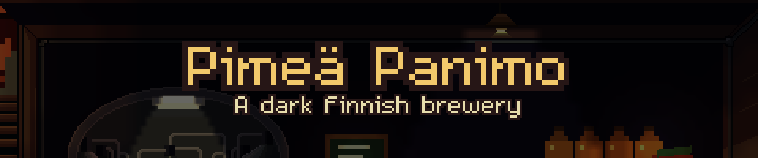
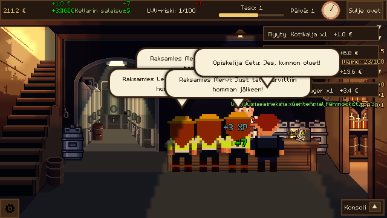
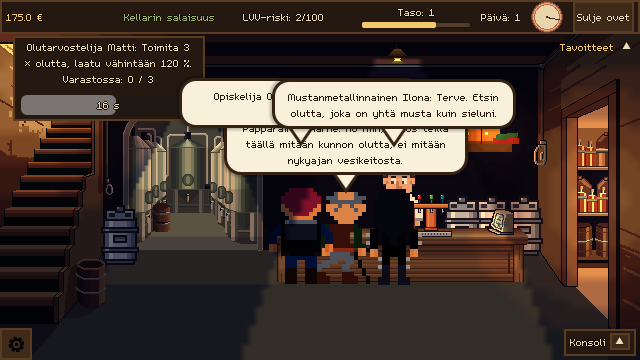
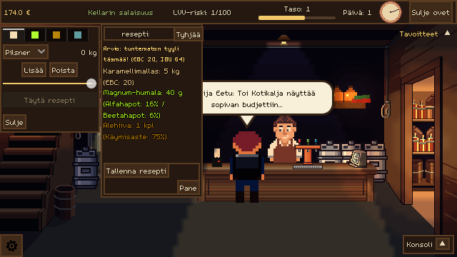
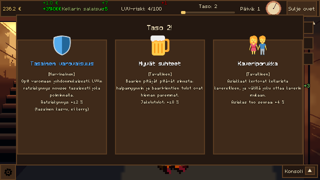

<p align="center">
  
</p>

<p align="center">
  <a href="https://velluv.itch.io/pimea-panimo-demo"></a>
  <a href="https://velluvu.github.io/pimea-panimo-godot4/"></a>
  
</p>

<p align="center"><i>Kellarissa on pimeää, kattila kuplii ja ovelta kuuluu koputus.<br>
Onko se asiakas, vai LVV:n tarkastaja?</i></p>

---

## 🍺 Tervetuloa kellariin

**Pimeä Panimo** is a humorous brewery management game from Finland. You run a not-quite-legal brewery in a dark cellar:
pick malts, hops and yeast for your own beer styles, pour them for a parade of strange regulars, and keep one eye on the door,
because the alcohol inspectors of **LVV** are always one rumour away.

- 🧪 **Brew by feel, not by recipe.** Malts, hops and yeast mix into two dozen styles, from *kotikalja* to Baltic porter and sahti.
- 🍻 **Serve the weirdest regulars in town.** Builders in hi-vis, a beer critic, a monk, a mafioso, a delivery robot, a lion fan, and plenty more, each with their own taste and requests.
- 🚨 **Dodge the LVV.** Every sale raises the risk. Bribe, hide the stash or go legit with alcohol-free brews before the raid comes.
- 📈 **Grow the cellar.** Bigger fermenters, more counter seats, cold conditioning, and the *Olutoppi* talents that carry over from season to season.
- 🏆 **Climb the global leaderboard.** The browser demo has a shared top list. Can you out-brew everyone else in one short season?

The game is in Finnish, with English in the options. The demo plays in any desktop or phone browser.

## 📸 Kuvia kellarista

<table>
  <tr>
    <td></td>
    <td></td>
  </tr>
  <tr>
    <td></td>
    <td></td>
  </tr>
</table>

---

<details>
<summary><b>🔧 For developers: how the game is built</b></summary>

<br>

Built in **Godot 4 (GDScript)**. Code and comments are in English; all in-game text is Finnish, with an English translation.

## 💎 Architectural & Technical Highlights

*   **Recursively Self-Loading Databases**: `ingredient_database.gd` and `customer_registry.gd` bypass hardcoded data lists entirely. They scan their resource directories on startup and compile centralized dictionaries of every custom `Resource` (`IngredientData`, `MaltData`, `HopData`, `CustomerData`, etc.), keyed by unique ID.
*   **Event-Driven, Decoupled Pull-Model UI**: The GUI never reaches into game logic directly. Autoload signal buses (`brewery_signals.gd`, `gui_signals.gd`) broadcast state changes; UI panels react and *pull* only the data they need. "Signal up, method down" — no hardcoded node paths.
*   **Zero-Garbage UI Node Recycling**: Dynamic containers (the warehouse cabinet, the preparation table) don't instantiate or `queue_free()` rows during gameplay. Rows are built once on `_ready()` in ID-order; the UI just toggles visibility and updates values.
*   **Strongly Typed, Object-Oriented Inventory**: `inventory.gd` protects state with a multi-layered nested dictionary (`items[Type][ID] = InventoryItem`). Mutable runtime quantities are fully decoupled from the immutable `.tres` static data resources.
*   **Math-Based Crafting Resolver**: `brew_resolver.gd` doesn't use rigid fixed recipes — it weighs malt EBC color, hop alpha-acids, and yeast attenuation to dynamically deduce which beer style emerges from a given batch.
*   **Data-Driven Everything**: Ingredients, beer styles, customers, and special events all live as custom `Resource` (`.tres`) definitions under `src/resources/`, loaded automatically rather than hardcoded into scripts.

---

## 📂 Project Architecture

```text
📁 addons/                  Godot plugins (the godot_ai MCP plugin, dev tools)
📁 assets/                  Audio, fonts, shaders, textures
📁 src/                     The game
  📁 scenes/                Scenes and their bound scripts: main.tscn, customer.tscn, ui/ windows and panels
  📁 systems/               Reusable systems you can copy to another project (see systems/README.md)
    achievements/, audio/, console/, dialog/, goals/, input/, save/, settings/
                              Have a *_wiring.gd, the only project-specific file
    toast/, tooltip/, toolkit/  Need no wiring
  📁 autoload/              Signal buses (brewery_signals, gui_signals), registries and managers
  📁 brewing/               Ingredients, recipes, BrewResolver and its parts, inventory
  📁 brewery/               The Brewery run state and its services
  📁 customers/             Customers, spawning, group visits, sales
  📁 events/                Special, day and immersion events
  📁 progression/           Perks, meta unlocks (Olutoppi), run score, daily goals
  📁 ui/                    UI helper classes (text, layout, hover areas)
  📁 console/               The game's console commands
  📁 audio/                 Audio bank (which sound plays for what)
  📁 resources/             All content as .tres files, one folder per type
📁 tests/                   Unit tests, one test_<class>.gd per class
📁 dev/                     Development only: tools/, docs/, notes/ (local)
    tools/playtest/           Headless bot playtests for balance checks
    tools/web/                Browser smoke test for the web demo (headless Chrome)
    tools/i18n.py             Keeps the English translation in step with the Finnish texts
    tools/sheets.py           Customers and beer styles to spreadsheets and back
    tools/sfx/, tools/fonts/  Sound effect synthesizer, font metric fitting
    tools/check_systems.py    Checks that every system folder is self-contained
```

---

## 🛠️ Running the Project

```bash
# Run the project (editor-configured main scene)
godot --path .

# Run a specific scene directly
godot res://src/scenes/main.tscn

# Headless run (e.g. for CI / quick sanity checks)
godot --headless --quit
```

Requires **Godot 4.7** (GL Compatibility renderer).

### Web demo

```bash
# Export the demo (needs the Godot 4.7 export templates)
godot --headless --path . --export-release "Web Demo" build/web/index.html
```

The **Web Demo** preset sets the `demo` feature tag, which ends the season when day 5 begins (`DemoRules`). GitHub Pages is published by the *Web demo* workflow (Actions tab → Run workflow); for itch.io, zip the contents of `build/web/` and upload it as an HTML game. See [dev/docs/browser_demo_plan.md](dev/docs/browser_demo_plan.md).

---

## 🤖 AI-Assisted Development

This project uses a live **Godot Editor MCP plugin** (`addons/godot_ai/`) so an AI assistant can inspect the running scene tree, read runtime errors, and modify nodes directly in the editor rather than guessing at structure. See [CLAUDE.md](CLAUDE.md) for the full set of architecture rules, code style, and AI collaboration guidelines this repo follows.

</details>

---

## 📜 License

Copyright (c) 2026 VelluVu. All Rights Reserved. 

This repository contains proprietary software. 
While the source code is publicly visible for transparency, security auditing, and portfolio evaluation, no open-source rights are granted.
